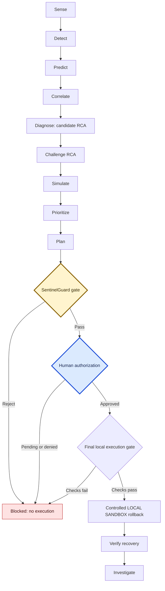

# SentinelOps AI

SentinelOps AI is an engineering demo of how software problems can be detected, investigated, and handled cautiously. Explore made-up scenarios in your browser, follow the evidence, and see why a proposed recovery must pass safety checks and human approval. The configured recovery path runs in a local sandbox; the demo does not operate production systems.

[](https://github.com/abhay799/sentinelops-ai/actions/workflows/frontend-and-evidence.yml)

[Live demo](https://sentinelops-ai-weld.vercel.app) · [Offline demo](https://abhay799.github.io/sentinelops-ai/control-center/) · [Portfolio](https://abhay799.github.io/sentinelops-ai/)

The CI badge reports the combined workflow containing the `python-tests` job and frontend/evidence checks. The live demo displays deterministic synthetic scenarios; it does not connect to production infrastructure.

Reliability intelligence and failure-prevention engineering for distributed-system demos. SentinelOps turns local, generated evidence into detection, investigation, safety-gated planning, and controlled local sandbox recovery decisions.

> **Current boundary:** LOCAL, SYNTHETIC, DETERMINISTIC, and NOT CONNECTED to production infrastructure. Counterfactuals are SIMULATED; production performance is NOT MEASURED.

## Reliability lifecycle

`Sense → Detect → Predict → Correlate → Diagnose → Challenge RCA → Simulate → Prioritize → Plan → Guard → Human Authorization → Controlled Execution → Verify → Investigate`



The final execution gate still checks the local target, rollback availability, and configured adapter. A Guard pass or human approval alone does not authorize execution.

## Safety invariant

```text
NO REMEDIATION WITHOUT
EVIDENCE + CONFIDENCE + SAFETY + AUTHORIZATION + ROLLBACK + VERIFICATION
```

RCA output remains a hypothesis. Agents cannot independently confirm RCA, execute remediation, bypass SentinelGuard, or bypass human approval. The execution boundary is **LOCAL SANDBOX**: `rollback` is the configured adapter; `traffic_shift` and `restart` are planning/allowlist concepts only.

## Public deployment

Public hosting makes the demo UI and investigation artifact API accessible; it does not establish production infrastructure or telemetry connectivity. The LOCAL / SYNTHETIC / DETERMINISTIC / NOT CONNECTED boundaries remain in effect.

| Component | Host | What it runs | What it does NOT run |
| --- | --- | --- | --- |
| Frontend | [Vercel](https://sentinelops-ai-weld.vercel.app) | React/Vite Control Center with deterministic scenarios; can probe Railway API capabilities when `VITE_API_BASE` is configured | Backend services, the ML pipeline, production telemetry ingestion, or remediation execution |
| Backend | [Railway](https://sentinelops-ai-backend-production.up.railway.app) | FastAPI serving precomputed Phase 15 investigation artifacts and the `/live`, `/ready`, `/capabilities`, and `/investigation/latest` endpoints | Kafka, PostgreSQL, Redis, Prometheus, the ML pipeline, or remediation execution |
| Offline demo and portfolio | [GitHub Pages](https://abhay799.github.io/sentinelops-ai/) | Static portfolio and [offline Control Center](https://abhay799.github.io/sentinelops-ai/control-center/) using the `demo` provider | A backend API, Railway API calls in the offline demo, infrastructure services, or pipeline execution |

The public backend serves precomputed Phase 15 investigation artifacts via FastAPI. It does **not** run Kafka, PostgreSQL, Redis, Prometheus, or the ML pipeline. An API request reads an existing report; it does not generate a new investigation. Even when API capabilities are reachable, the current frontend continues to display deterministic synthetic scenarios.

Set the Vercel build variable `VITE_API_BASE` to `https://sentinelops-ai-backend-production.up.railway.app`. The backend's CORS origin allowlist includes `https://sentinelops-ai-weld.vercel.app`. `requirements-deploy.txt` is intentionally minimal for this artifact API (FastAPI and Uvicorn), not a full pipeline installation. The first request after idle may be slow. See [deployment details](docs/DEPLOYMENT.md) for configuration, endpoint semantics, and the separate GitHub Pages offline version.

## Quick demo

The committed React Control Center works offline with deterministic demo data:

```bash
cd frontend
npm install
npm run dev
```

Vite prints the local URL. See [running locally](docs/RUNNING.md) for setup, API, infrastructure, tests, and shutdown instructions.

## Control Center and scenarios

The Control Center presents 15 reliability/SRE views through a provider boundary that supports deterministic `demo` data and optional `local-api` fallback. It is a local demonstration UI, not a live operations console.

Nine deterministic scenarios demonstrate cautious operation, RCA uncertainty, Guard rejection, pending human authorization, local recovery, and safe failure. See [scenario documentation](docs/demo/SCENARIOS.md).

## Architecture, evidence, and validation

- [Project architecture](docs/architecture/PROJECT_ARCHITECTURE.md) and [phase index](docs/architecture/PHASE_INDEX.md)
- [System overview](docs/architecture/SYSTEM_OVERVIEW.md), [execution lifecycle](docs/architecture/EXECUTION_LIFECYCLE.md), and [safety control plane](docs/architecture/SAFETY_CONTROL_PLANE.md)
- [Safety invariants](docs/architecture/SAFETY_INVARIANTS.md), [limitations](docs/LIMITATIONS.md), and [validation scope](docs/VALIDATION.md)
- [Benchmarks and evidence](docs/evidence/BENCHMARKS_AND_EVIDENCE.md) and [evidence manifest](docs/evidence/EVIDENCE_MANIFEST.json)
- [Static Pages packaging](docs/PAGES.md) and [internal release certification](docs/RELEASE_CERTIFICATION.md)

Historical Phase 10 development metrics are measured on synthetic/development data, not production-calibrated. Git tags are historical internal certification markers, not external certification.

## Implemented vs simulated vs not connected

These distinctions follow [limitations](docs/LIMITATIONS.md) and [validation scope](docs/VALIDATION.md). **IMPLEMENTED** means repository code, configuration, scripts, or tests provide evidence; it does not alone establish deployment, connectivity, or operational approval.

| Capability | IMPLEMENTED evidence | SIMULATED / SYNTHETIC / DETERMINISTIC boundary | NOT CONNECTED / not validated |
| --- | --- | --- | --- |
| Detection and prediction | Feature, anomaly, and temporal prediction code/tests | Development and SYNTHETIC inputs; historical metrics are development measurements | Production prediction performance, calibration, and business impact are NOT MEASURED |
| Graphs, incidents, and RCA | Graph intelligence, incident correlation, and RCA/challenger tests | Candidate hypotheses from local evidence; RCA remains unconfirmed | Agents cannot independently confirm RCA |
| Counterfactuals and planning | Counterfactual, priority/impact, and remediation/SentinelGuard code/tests | SIMULATED projected risk and benefit; comparisons cannot authorize execution | Live counterfactual correctness and actual remediation effectiveness are not validated |
| Controlled recovery | LOCAL SANDBOX `rollback` adapter with Guard, human approval, local-target, rollback, adapter, and verification checks | Control Center recovery scenarios use deterministic SYNTHETIC data | Production execution is NOT CONNECTED; `traffic_shift` and `restart` are planning/allowlist concepts, not validated execution adapters |
| Grounded investigation | `DeterministicGroundedProvider` and local TF-IDF runbook retrieval | DETERMINISTIC evidence investigation; agents have no execution or independent RCA-confirmation authority | No hosted model-provider connection is established |
| Control Center | Committed frontend source (27 tracked files) and deterministic demo provider | LOCAL / SYNTHETIC / DETERMINISTIC demonstration UI | Production operations connectivity and frontend production readiness are not established |
| Infrastructure and telemetry | Local Docker Compose services and local URLs | Local development/demo environment | Production infrastructure and telemetry are NOT CONNECTED; production access control, coverage, and scale are not validated |

## Screenshot / demo media

No screenshots or demo media are committed yet. This section is intentionally a placeholder until reproducible assets are added.

Placeholder records live in [docs/media/SCREENSHOT_PLACEHOLDERS.md](docs/media/SCREENSHOT_PLACEHOLDERS.md). Every entry below is **PENDING CAPTURE**, not an image or evidence of a completed recovery. The records contain exact browser routes, scenario choices, filenames, and reproduction steps; the [capture guide](docs/media/CAPTURE_GUIDE.md) defines review requirements.

| Planned capture | Placeholder and exact reproduction steps |
| --- | --- |
| Mission Control | [PENDING CAPTURE — `mission-control.png`](docs/media/SCREENSHOT_PLACEHOLDERS.md#mission-control) |
| Service Health | [PENDING CAPTURE — `service-health.png`](docs/media/SCREENSHOT_PLACEHOLDERS.md#service-health) |
| RCA Intelligence | [PENDING CAPTURE — `rca-intelligence.png`](docs/media/SCREENSHOT_PLACEHOLDERS.md#rca-intelligence) |
| RCA Challenger | [PENDING CAPTURE — `rca-challenger.png`](docs/media/SCREENSHOT_PLACEHOLDERS.md#rca-challenger) |
| SentinelGuard | [PENDING CAPTURE — `sentinelguard.png`](docs/media/SCREENSHOT_PLACEHOLDERS.md#sentinelguard) |
| Safe Local Recovery | [PENDING CAPTURE — `safe-local-recovery.png`](docs/media/SCREENSHOT_PLACEHOLDERS.md#safe-local-recovery) |
| Investigation | [PENDING CAPTURE — `investigation.png`](docs/media/SCREENSHOT_PLACEHOLDERS.md#investigation) |
| System Status | [PENDING CAPTURE — `system-status.png`](docs/media/SCREENSHOT_PLACEHOLDERS.md#system-status) |
| Portfolio Home | [PENDING CAPTURE — `portfolio-home.png`](docs/media/SCREENSHOT_PLACEHOLDERS.md#portfolio-home) |

## Repository structure

```text
configs/     Runtime and safety configuration
docs/        Architecture, evidence, scenarios, and running guides
frontend/    React/Vite local Control Center
infra/       Docker Compose local infrastructure
monitoring/  Prometheus and OpenTelemetry configuration
scripts/     Phase build, preflight, and local API entry points
services/    Seven local demo services
src/         SentinelOps Python implementation
tests/       Python contract and phase tests
```

## Status and limitations

Repository implementation evidence covers Phases 0–15. Generated `data/processed/` artifacts and model binaries are local/Git-ignored and are not durable public evidence. Production infrastructure and telemetry are NOT CONNECTED; production benchmarks are NOT MEASURED. The package version is `0.1.0`. The `sentinelops-v1.0.0` Git tag is an internal milestone marker, not the Python package version; the existing tag and history remain unchanged.

No Kubernetes or Helm assets are present. `scripts/phase15_preflight.py` and `tests/test_phase15_final.py` are absent; existing Phase 15 evidence is documented in the validation and evidence guides.

## Contributing and security

See [CONTRIBUTING.md](CONTRIBUTING.md) and [SECURITY.md](SECURITY.md). No license file has been selected for this repository.
